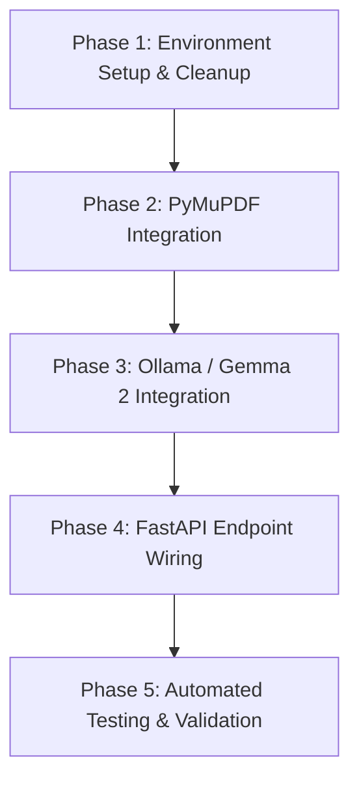

# Architecture Specification: Local Privacy-First Invoice Extractor Microservice

**Document Version:** 1.0.0  
**Target Audience:** Freelance Accountants handling confidential client financial documents  
**Core Directive:** 100% Local Execution, Zero Cloud Leakage, Zero API Costs  

---

## 1. Executive Summary & Current State Audit

### 1.1 Objective
Transform the legacy repository from a cloud-dependent demo into an enterprise-grade, offline-capable FastAPI microservice. The service extracts structured invoice data from native PDF invoices using `PyMuPDF` and `gemma2:2b` via a local `Ollama` instance, guaranteeing zero transmission of financial data beyond `localhost`.

### 1.2 Current State Repository Audit

| File | Current Role | Planned Action | Rationale |
| :--- | :--- | :--- | :--- |
| `vision.py` | Streamlit demo calling Google Gemini (`gemini-pro-vision`) via `google.generativeai` with cloud API keys. | **DELETE** | Cloud-dependent, violates zero-cloud-leakage requirement, interactive UI unsuited for microservice architecture. |
| `requirements.txt` | Lists `streamlit`, `google-generativeai`, `python-dotenv`, `langchain`, `PyPDF2`, `chromadb`, `faiss-cpu`. | **REWRITE** | Purge all cloud vendor SDKs and unused vector DB dependencies. Replace with lean local stack (`fastapi`, `uvicorn`, `pymupdf`, `ollama`, `pydantic>=2.0`, `python-multipart`, `pytest`, `httpx`). |
| `.gitignore` | Standard Python gitignore. | **UPDATE** | Append rules for local temporary uploads (`/temp_uploads`), Ollama test caches, and coverage artifacts. |
| `LICENSE` | GNU GPL v3. | **KEEP** | Maintain open-source licensing compliance. |

### 1.3 Target Directory Structure

```text
Invoice-Extractor-LLM-APP/
├── app/
│   ├── __init__.py
│   ├── config.py           # Configuration (Ollama URL, model name, max context chars)
│   ├── pdf_parser.py       # PyMuPDF ingestion, multi-page concatenation, OCR detector
│   ├── extractor.py        # Pydantic v2 schemas & Ollama Gemma 2 structured inference
│   └── main.py             # FastAPI app, /api/v1/extract endpoint, exception handlers
├── tests/
│   ├── __init__.py
│   ├── conftest.py         # Pytest fixtures and test helpers
│   ├── test_pdf_parser.py  # Tests for text extraction, OCR detection, truncation
│   ├── test_extractor.py   # Tests for schema validation and LLM extraction
│   └── test_api.py         # Integration tests for FastAPI endpoints
├── sample_data/
│   └── generate_sample.py  # Utility script to generate native & scanned test PDFs
├── requirements.txt        # Production & runtime dependencies
├── .gitignore
├── README.md               # Setup & offline operations guide
└── SPEC.md                 # Architecture blueprint (this document)
```

---

## 2. System Architecture & Data Flow

### 2.1 Text-Based Sequence Diagram

```text
[ Client (Accountant / TabPFN Pipeline) ]
                   │
                   │ 1. POST /api/v1/extract (multipart/form-data: PDF)
                   ▼
       [ FastAPI Router (main.py) ]
                   │
                   │ 2. Validate MIME type & file extension (.pdf)
                   │ 3. Stream bytes to memory / temp spool
                   ▼
     [ PDF Ingestion Layer (pdf_parser.py) ]
                   │
                   │ 4. Open document via PyMuPDF (fitz)
                   │ 5. Iterate through pages & extract text blocks
                   │
          [ Has Text Layer? ]
                ├── NO (len(text) < 30 chars) ──► Return HTTP 400 Bad Request
                │                                 ("OCR not supported yet, please upload a native PDF")
                │
                └── YES (Valid native text)
                        │
                        │ 6. Enforce token/char limit (e.g., 12,000 chars)
                        ▼
      [ LLM Extraction Layer (extractor.py) ]
                   │
                   │ 7. Construct deterministic system prompt
                   │ 8. Call ollama.chat(model="gemma2:2b", format=InvoiceData.model_json_schema())
                   ▼
          [ Local Ollama Instance (gemma2:2b) ]
                   │
                   │ 9. Execute GBNF grammar-constrained sampling locally (localhost:11434)
                   │ 10. Emit deterministic, schema-compliant JSON string
                   ▼
      [ Pydantic Validation & Normalization ]
                   │
                   │ 11. InvoiceData.model_validate_json(raw_json)
                   ▼
       [ Downstream TabPFN Ready Response ]
                   │
                   │ 12. Return HTTP 200 with structured JSON
                   ▼
                [ Client ]
```

---

## 3. Component Specifications

### 3.1 PDF Ingestion Layer (`app/pdf_parser.py`)
*   **Engine:** `PyMuPDF` (`fitz`).
*   **Input:** File bytes or file path of the uploaded document.
*   **Multi-Page Handling:** Iterates sequentially through `doc.pages()`, concatenating text with clear page markers (`--- Page X ---`).
*   **Scanned/Image Detection:**
    *   If total stripped text length is below a configurable threshold (default: 30 non-whitespace characters), raise `ScannedPDFError`.
    *   The API router catches this and returns an immediate `HTTP 400` with:
        ```json
        {
          "detail": "OCR not supported yet, please upload a native PDF"
        }
        ```
*   **Context Window Safeguard:**
    *   `gemma2:2b` has an 8,192 token context window. To guarantee deterministic output and prevent VRAM exhaustion on local hardware, enforce a maximum character threshold (default: 12,000 characters, ~3,000 tokens). Text beyond this limit is cleanly truncated with a metadata flag indicating truncation.

### 3.2 Local LLM Extraction Layer (`app/extractor.py`)
*   **Inference Engine:** `ollama` Python SDK pointing to `http://localhost:11434`.
*   **Target Model:** `gemma2:2b`.
*   **Data Models (Pydantic v2):**

```python
from pydantic import BaseModel, Field
from typing import List, Optional

class LineItem(BaseModel):
    description: str = Field(..., description="Description of the goods or services rendered")
    quantity: float = Field(default=1.0, description="Quantity of items")
    unit_price: float = Field(default=0.0, description="Unit price per item")
    total_price: float = Field(default=0.0, description="Calculated total price (quantity * unit_price)")

class InvoiceData(BaseModel):
    vendor_name: str = Field(..., description="Name of the company or vendor issuing the invoice")
    invoice_number: str = Field(..., description="Unique invoice identifier or code")
    invoice_date: str = Field(..., description="Date of the invoice formatted as YYYY-MM-DD or as written")
    total_amount: float = Field(..., description="Final invoice balance or total amount due")
    tax_amount: float = Field(default=0.0, description="Total VAT/GST/sales tax amount")
    line_items: List[LineItem] = Field(default_factory=list, description="Extracted individual invoice items")
```

*   **Ollama Native Structured Output:**
    *   Leverages `format=InvoiceData.model_json_schema()` in `ollama.chat()`.
    *   Forces Ollama's underlying llama.cpp grammar sampler to emit valid JSON matching the exact Pydantic schema.
*   **Deterministic System Prompt:**
    ```text
    You are a specialized deterministic financial information extraction engine.
    Extract the invoice fields from the provided document text.
    Strictly adhere to the following rules:
    1. Extract data only if explicitly stated or directly inferable from the text.
    2. Format all numbers as floats. If tax is not specified, use 0.0.
    3. Normalize dates to YYYY-MM-DD where possible.
    4. Do not include markdown codeblocks, explanatory preamble, or conversational commentary.
    ```
*   **Downstream TabPFN Compatibility:**
    *   The structured response format can be directly ingested into pandas via `pd.json_normalize(response["line_items"])` or `pd.DataFrame([response])` for TabPFN tabular anomaly detection pipelines.

### 3.3 API Routing Layer (`app/main.py`)
*   **Framework:** FastAPI with async routes.
*   **Endpoints:**
    1.  `GET /health`: Checks local microservice status and verifies Ollama connectivity and `gemma2:2b` availability.
    2.  `POST /api/v1/extract`: Accepts `multipart/form-data` with `file: UploadFile`.
*   **Error Handling Matrix:**
    *   `400 Bad Request`: Non-PDF file uploaded OR PDF has no text layer (scanned/raster image).
    *   `422 Unprocessable Entity`: Document text valid, but essential schema fields cannot be resolved.
    *   `503 Service Unavailable`: Local Ollama daemon is unreachable (e.g., service not started).

---

## 4. Phased Implementation Plan



### Phase 1: Environment Setup & Cleanup
1.  Remove `vision.py`.
2.  Update `requirements.txt` with clean, local-only dependencies:
    *   `fastapi>=0.110.0`
    *   `uvicorn[standard]>=0.28.0`
    *   `pydantic>=2.6.0`
    *   `pymupdf>=1.23.0`
    *   `ollama>=0.1.7`
    *   `python-multipart>=0.0.9`
    *   `pytest>=8.0.0`
    *   `httpx>=0.27.0`
    *   `reportlab>=4.1.0` (for generating local mock test PDFs)
3.  Update `.gitignore` to ignore temporary files, test outputs, and caches.
4.  Verify local Python environment and Ollama installation prerequisites.

### Phase 2: PyMuPDF Integration (`app/pdf_parser.py`)
1.  Implement `extract_text_from_pdf(file_bytes: bytes) -> str`.
2.  Implement `ScannedPDFError` exception when extracted characters < 30.
3.  Implement context window length limiter (`truncate_text_for_context`).
4.  Write isolated unit tests with mock multi-page and empty/scanned PDFs.

### Phase 3: Ollama / Gemma 2 Integration (`app/extractor.py`)
1.  Define Pydantic v2 schemas: `LineItem`, `InvoiceData`.
2.  Build `OllamaExtractor` class with configurable `model_name` and `host`.
3.  Implement `extract_invoice(text: str) -> InvoiceData` with `format=InvoiceData.model_json_schema()`.
4.  Add fallback and resilience handling for local model execution errors.

### Phase 4: FastAPI Endpoint Wiring (`app/main.py`)
1.  Configure application settings via `app/config.py`.
2.  Wire `POST /api/v1/extract` accepting `UploadFile`.
3.  Add custom exception handlers translating `ScannedPDFError` to HTTP 400.
4.  Add `GET /health` with Ollama model readiness check.

### Phase 5: Testing & Verification
1.  Create automated test suite under `tests/`:
    *   `test_pdf_parser.py`: Tests text extraction & empty PDF detection.
    *   `test_extractor.py`: Tests Pydantic parsing with mock and live responses.
    *   `test_api.py`: Tests FastAPI endpoint status codes (200, 400 for OCR, 422 for invalid format).
2.  Provide sample `curl` commands for end-to-end verification.

---

## 5. Verification & Test Commands

### 5.1 Health Check
```bash
curl -X GET http://127.0.0.1:8000/health
```
**Expected Response:**
```json
{
  "status": "healthy",
  "ollama_connected": true,
  "model": "gemma2:2b"
}
```

### 5.2 Native PDF Extraction (Success)
```bash
curl -X POST "http://127.0.0.1:8000/api/v1/extract" \
     -H "accept: application/json" \
     -H "Content-Type: multipart/form-data" \
     -F "file=@sample_invoice.pdf;type=application/pdf"
```
**Expected Response:**
```json
{
  "vendor_name": "Acme Supplies Ltd",
  "invoice_number": "INV-2024-001",
  "invoice_date": "2024-03-15",
  "total_amount": 1250.50,
  "tax_amount": 125.05,
  "line_items": [
    {
      "description": "Consulting Services",
      "quantity": 10.0,
      "unit_price": 100.0,
      "total_price": 1000.0
    },
    {
      "description": "Software License",
      "quantity": 1.0,
      "unit_price": 125.45,
      "total_price": 125.45
    }
  ]
}
```

### 5.3 Scanned Image / No Text Layer (Error Handling)
```bash
curl -X POST "http://127.0.0.1:8000/api/v1/extract" \
     -H "accept: application/json" \
     -H "Content-Type: multipart/form-data" \
     -F "file=@scanned_image.pdf;type=application/pdf"
```
**Expected Response (HTTP 400 Bad Request):**
```json
{
  "detail": "OCR not supported yet, please upload a native PDF"
}
```

---

## 6. Offline & Zero Cloud Leakage Compliance Checklist
- [x] Zero API keys required or referenced in code.
- [x] Zero network calls outside `127.0.0.1` / `localhost`.
- [x] Runs completely offline with network interface disabled.
- [x] Client confidential invoice data stays strictly in local RAM / local process memory.
